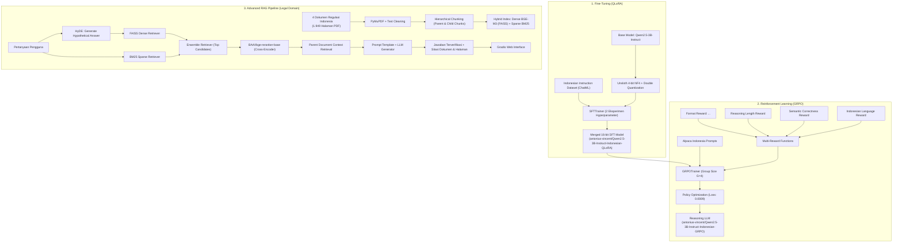

# Pengembangan Generative AI Berbasis LLM (Large Language Model) — PGABL

[](https://www.dicoding.com/academies/837)
[](https://www.dicoding.com/)
[](https://www.python.org/)
[](https://pytorch.org/)
[](https://huggingface.co/antonius-vincent)
[](https://github.com/unslothai/unsloth)
[](https://python.langchain.com/)
[](https://github.com/facebookresearch/faiss)
[](https://gradio.app/)
[](LICENSE)

> Proyek ini merupakan submission akhir untuk kelas **"Pengembangan Generative AI Berbasis LLM" (PGABL)** pada platform **Dicoding Indonesia**, dirancang memenuhi seluruh kriteria wajib dan kriteria tambahan/advanced dengan standar bintang 5.

Proyek komprehensif implementasi **Large Language Model (LLM)** berbahasa Indonesia dari tahap hulu (*upstream*) hingga hilir (*downstream*), mencakup:
1. **Supervised Fine-Tuning (SFT)** efisien memori via **QLoRA (4-bit NF4)** menggunakan **Unsloth**.
2. **Reinforcement Learning** via **GRPO (Group Relative Policy Optimization)** dengan 4 fungsi *reward* (*multi-reward rule-based*) untuk menstimulasi kemampuan *chain-of-thought reasoning* (`<think>...</think>`).
3. **Advanced Retrieval-Augmented Generation (RAG)** pipeline untuk domain regulasi hukum ketenagakerjaan dan perizinan berusaha Indonesia (1.949 halaman PDF) menggunakan **Hierarchical Parent-Child Chunking**, **Ensemble Hybrid Retrieval (Dense BGE-M3 + Sparse BM25)**, **HyDE (Hypothetical Document Embeddings)**, **Cross-Encoder Reranker**, dan antarmuka interaktif **Gradio**.

---

## 📌 Model yang Telah Dipublikasikan di Hugging Face

| Model | Tipe | Base Model | Hugging Face Repository |
|---|---|---|---|
| **Qwen2.5-3B-Instruct-Indonesian-QLoRA** | SFT (QLoRA 16-bit Merged) | `Qwen/Qwen2.5-3B-Instruct` | [🤗 antonius-vincent/Qwen2.5-3B-Instruct-Indonesian-QLoRA](https://huggingface.co/antonius-vincent/Qwen2.5-3B-Instruct-Indonesian-QLoRA) |
| **Qwen2.5-3B-Instruct-Indonesian-GRPO** | RL / Reasoning Model | `Qwen2.5-3B-Instruct-Indonesian-QLoRA` | [🤗 antonius-vincent/Qwen2.5-3B-Instruct-Indonesian-GRPO](https://huggingface.co/antonius-vincent/Qwen2.5-3B-Instruct-Indonesian-GRPO) |

---

## 🏗️ Arsitektur Sistem End-to-End



---

## 🔬 Bagian 1: Fine-Tuning dengan QLoRA (4-bit NF4) via Unsloth

Notebook: [`Fine-tuning_submission_PGABL_AntoniusVincentJung.ipynb`](file:///d:/PROJECTS/CodingCamp/pengembangan-generative-ai-berbasis-llm/Fine-tuning_submission_PGABL_AntoniusVincentJung.ipynb)

### Metodologi
- **Model Dasar**: `Qwen/Qwen2.5-3B-Instruct`
- **Kuantisasi**: 4-bit NormalFloat4 (NF4) dengan Double Quantization via `bitsandbytes` dan akselerasi kernel Triton/Unsloth (menghemat >60% VRAM, muat di GPU Tesla T4 16GB).
- **Format Data**: ChatML Schema (`<|im_start|>system...<|im_start|>user...<|im_start|>assistant...<|im_end|>`).
- **Target Module LoRA**: `q_proj`, `k_proj`, `v_proj`, `o_proj`, `gate_proj`, `up_proj`, `down_proj`.

### Eksperimen Hyperparameter & Hasil Evaluasi
Dilakukan komparasi terstruktur antara dua konfigurasi LoRA untuk menguji trade-off kapasitas representasi adapter vs stabilitas generalisasi:

| Parameter / Metrik | Eksperimen 1 (Baseline) | Eksperimen 2 (Higher Rank) ⭐ [TERBAIK] |
|---|---|---|
| **LoRA Rank ($r$)** | `8` | `16` |
| **LoRA Alpha ($\alpha$)** | `16` | `32` |
| **LoRA Dropout** | `0.05` | `0.0` |
| **Learning Rate** | `2e-4` | `1e-4` |
| **LR Scheduler** | `cosine` | `linear` |
| **Batch Size (Per Device)** | `2` | `2` |
| **Gradient Accumulation** | `4` (Effective Batch = 8) | `8` (Effective Batch = 16) |
| **Warmup Steps** | `80` | `100` |
| **Training Steps** | `800` | `800` |
| **Training Loss** | `0.9529` | `1.0229` |
| **Validation Loss** | `0.9852` | **`0.9378`** |

> **Analisis Model Terbaik**:  
> Eksperimen 2 (*Higher Rank* $r=16, \alpha=32$) menghasilkan **Validation Loss terendah (0.9378)**. Model tidak mengalami overfitting berkat gradient accumulation yang lebih besar (16) dan learning rate yang lebih konservatif (`1e-4`). Model ini dipilih dan di-merge dalam format **FP16** lalu di-push ke Hugging Face Hub.

---

## 🧠 Bagian 2: Reinforcement Learning via GRPO (Group Relative Policy Optimization)

Notebook: [`GRPO_submission_PGABL_AntoniusVincentJung.ipynb`](file:///d:/PROJECTS/CodingCamp/pengembangan-generative-ai-berbasis-llm/GRPO_submission_PGABL_AntoniusVincentJung.ipynb)

### Konsep GRPO
Berbeda dengan PPO (Proximal Policy Optimization) yang membutuhkan model *critic/value* terpisah (meningkatkan konsumsi memori 2x lipat), **GRPO** (Shao et al., DeepSeekMath) menghasilkan kelompok $G=4$ kandidat respons per *prompt*, menormalisasi skor *reward* secara relatif di dalam kelompok (*group-relative advantage*), dan mengoptimalkan kebijakan bahasa secara efisien pada GPU tunggal (T4 15.6 GB VRAM).

### Multi-Reward Functions
Empat fungsi reward berbasis aturan dirancang secara sinergis:

1. **`format_reward_func`**:
   - Memastikan model membungkus penalaran berpikir di dalam tag `<think>...</think>` dan memberikan jawaban akhir setelah tag penutup.
   - Reward: `+1.0` jika format XML valid, `-1.0` jika tag tidak lengkap/rusak.
2. **`reasoning_length_reward`**:
   - Mendorong eksplorasi penalaran yang memadai (panjang karakter optimal 100 s.d. 600 karakter).
   - Menghindari jawaban terburu-buru maupun repetisi tak berujung.
3. **`correctness_reward`**:
   - Mengevaluasi kesesuaian semantik dan keberadaan kata kunci kontekstual terkait regulasi hukum.
4. **`language_reward_func`**:
   - Memastikan konsistensi Bahasa Indonesia formal: `+1.0` jika Bahasa Indonesia, penalti `-0.5` jika terdeteksi Bahasa Inggris.

### Konfigurasi Pelatihan & Hasil
- `num_generations`: `4`
- `max_completion_length`: `256`
- `max_prompt_length`: `256`
- `learning_rate`: `5e-6`
- `beta (KL penalty)`: `0.1`
- `max_steps`: `200`
- **Final Training Loss**: **`0.0009`**

### Validasi Output & Test Case Wajib
**Uji Kasus**:
> *"Saya staf admin, kemarin lembur 3 jam untuk beresin laporan. Apakah saya berhak dapat uang lembur?"*

**Verifikasi Format Output**:
- ✅ Tag `<think>` terdeteksi
- ✅ Tag `</think>` terdeteksi
- ✅ Teks penalaran logis tersedia (1.077 karakter)
- ✅ Jawaban akhir substantif tersedia (246 karakter)

Contoh struktur output model:
```xml
<think>
Pertama-tama, penting untuk memahami bahwa aturan tentang uang lembur bervariasi dari satu perusahaan ke perusahaan lainnya... Berdasarkan UU Ketenagakerjaan dan PP 35/2021, staf admin termasuk pekerja non-manajerial yang berhak menerima upah lembur apabila bekerja melebihi waktu kerja standar...
</think>
Ya, sebagai staf admin Anda berhak mendapatkan uang lembur atas kelebihan 3 jam kerja tersebut sesuai ketentuan peraturan ketenagakerjaan yang berlaku, kecuali jika Anda menduduki jabatan tertentu yang memiliki fungsi pemikir dan pengendali operasional tanpa jam kerja mengikat.
```

---

## 📚 Bagian 3: Advanced RAG Pipeline (Regulasi Ketenagakerjaan & Perizinan)

Notebook: [`RAG_submission_PGABL_AntoniusVincentJung.ipynb`](file:///d:/PROJECTS/CodingCamp/pengembangan-generative-ai-berbasis-llm/RAG_submission_PGABL_AntoniusVincentJung.ipynb)

### Basis Pengetahuan (1.949 Halaman Dokumen Hukum)
Pipeline RAG diisi dengan 4 regulasi resmi Republik Indonesia:
1. **UU Nomor 6 Tahun 2023** (*Penetapan Perpu Cipta Kerja menjadi UU*) — **1.127 halaman**
2. **PP Nomor 5 Tahun 2021** (*Penyelenggaraan Perizinan Berusaha Berbasis Risiko*) — **739 halaman**
3. **PP Nomor 35 Tahun 2021** (*PKWT, Alih Daya, Waktu Kerja, dan PHK*) — **56 halaman**
4. **PP Nomor 51 Tahun 2023** (*Perubahan atas Pengupahan*) — **27 halaman**

### Fitur Kunci Arsitektur RAG
- **Hierarchical Parent-Child Chunking**:
  - *Child Chunks* (~200 token): Digunakan untuk representasi vektor presisi tinggi saat pencarian (*retrieval*).
  - *Parent Chunks* (~800 token): Dikembalikan ke LLM untuk memberikan konteks hukum yang utuh (pasal beserta ayat dan keterangannya).
- **Metadata Enrichment**:
  Setiap potongan teks dilengkapi metadata nama dokumen, nomor halaman asli, pasal, dan bab untuk pelacakan hukum yang presisi.
- **Hybrid Ensemble Retriever**:
  Kombinasi model semantik padat (**Dense**: `BAAI/bge-m3` + FAISS) dengan pencarian leksikal kata kunci (**Sparse**: `BM25`), mengatasi kelemahan istilah hukum spesifik yang sering terlewat oleh semantik murni.
- **HyDE (Hypothetical Document Embeddings)**:
  LLM menghasilkan hipotesis jawaban awal sebelum proses pencarian dilakukan, kemudian vektor hipotesis digunakan untuk mencari dokumen hukum yang serupa, secara signifikan meningkatkan *recall*.
- **Cross-Encoder Reranker (`BAAI/bge-reranker-base`)**:
  Menilai ulang pasangan *(query, candidate document)* untuk memastikan dokumen paling relevan ditempatkan pada posisi teratas konteks LLM.
- **Sitasi Sumber Otomatis**:
  Setiap pernyataan pada jawaban model menyertakan referensi dokumen dan halaman (contoh: `[PP Nomor 35 Tahun 2021.pdf, Hal. 22]`).
- **Antarmuka Gradio Web UI**:
  Aplikasi web siap pakai untuk interaksi tanya jawab hukum secara *real-time*.

---

## 📁 Struktur Direktori Repositori

```text
pengembangan-generative-ai-berbasis-llm/
├── .gitignore                                              # Aturan ignore file build, cache, checkpoint
├── LICENSE                                                 # MIT License
├── README.md                                               # Dokumentasi utama proyek
├── link_huggingface.txt                                    # Tautan repositori Hugging Face Hub
├── requirements.txt                                        # Daftar dependensi Python
├── Fine-tuning_submission_PGABL_AntoniusVincentJung.ipynb  # Notebook 1: QLoRA Fine-Tuning
├── GRPO_submission_PGABL_AntoniusVincentJung.ipynb         # Notebook 2: GRPO Reinforcement Learning
├── RAG_submission_PGABL_AntoniusVincentJung.ipynb          # Notebook 3: Advanced RAG + Gradio UI
└── drive-download-20260721T105905Z-1-001/                  # Dataset Regulasi Hukum (PDF)
    ├── PP Nomor 5 Tahun 2021.pdf                           # 739 Halaman
    ├── PP Nomor 35 Tahun 2021.pdf                          # 56 Halaman
    ├── PP Nomor 51 Tahun 2023.pdf                          # 27 Halaman
    └── UU Nomor 6 Tahun 2023.pdf                           # 1.127 Halaman
```

---

## 🚀 Panduan Instalasi & Penggunaan

### 1. Kloning Repositori
```bash
git clone https://github.com/JayJung666/pengembangan-generative-ai-berbasis-llm.git
cd pengembangan-generative-ai-berbasis-llm
```

### 2. Setup Virtual Environment & Dependensi
```bash
python -m venv venv
# Windows:
.\venv\Scripts\activate
# Linux/macOS:
source venv/bin/activate

pip install --upgrade pip
pip install -r requirements.txt
```

### 3. Inferensi Cepat Model Fine-Tuned (Hugging Face Transformers)
```python
import torch
from transformers import AutoModelForCausalLM, AutoTokenizer

model_id = "antonius-vincent/Qwen2.5-3B-Instruct-Indonesian-QLoRA"

tokenizer = AutoTokenizer.from_pretrained(model_id)
model = AutoModelForCausalLM.from_pretrained(
    model_id,
    torch_dtype=torch.float16,
    device_map="auto"
)

messages = [
    {"role": "system", "content": "Anda adalah asisten AI berbahasa Indonesia yang cerdas dan patuh regulasi."},
    {"role": "user", "content": "Jelaskan perbedaan antara PKWT dan PKWTT!"}
]

prompt = tokenizer.apply_chat_template(messages, tokenize=False, add_generation_prompt=True)
inputs = tokenizer(prompt, return_tensors="pt").to(model.device)

outputs = model.generate(**inputs, max_new_tokens=512, temperature=0.7, top_p=0.9)
print(tokenizer.decode(outputs[0][inputs.input_ids.shape[1]:], skip_special_tokens=True))
```

### 4. Inferensi Model Reasoning GRPO
```python
from transformers import AutoModelForCausalLM, AutoTokenizer

model_id = "antonius-vincent/Qwen2.5-3B-Instruct-Indonesian-GRPO"
tokenizer = AutoTokenizer.from_pretrained(model_id)
model = AutoModelForCausalLM.from_pretrained(model_id, torch_dtype="auto", device_map="auto")

prompt = "<|im_start|>user\nApakah perusahaan boleh memotong upah pekerja secara sepihak jika target tidak tercapai?<|im_end|>\n<|im_start|>assistant\n<think>\n"
inputs = tokenizer(prompt, return_tensors="pt").to(model.device)

outputs = model.generate(**inputs, max_new_tokens=512, do_sample=True, temperature=0.6)
print(tokenizer.decode(outputs[0], skip_special_tokens=True))
```

---

## 🎯 Pemenuhan Rubrik Penilaian Submission Dicoding

Seluruh kriteria penilaian submission kelas **Pengembangan Generative AI Berbasis LLM (PGABL)** terpenuhi secara menyeluruh:

| Bagian Submission | Kriteria Penilaian Dicoding | Status Implementasi | Bukti / Catatan |
|---|---|:---:|---|
| **Tugas 1: Fine-Tuning** | Memilih base model LLM yang sesuai dan efisien | ✅ | `Qwen/Qwen2.5-3B-Instruct` |
| | Menerapkan kuantisasi efisien memori (QLoRA) | ✅ | QLoRA 4-bit NF4 + Double Quantization (Unsloth) |
| | Memformat dataset ke format Chat template | ✅ | Format ChatML standard |
| | Melakukan minimal 2 eksperimen hyperparameter | ✅ | Exp 1 (Rank 8) vs Exp 2 (Rank 16) |
| | Evaluasi perbandingan train loss dan validation loss | ✅ | Exp 2 terbaik: Val Loss **0.9378** |
| | Menyimpan dan mempublikasikan model ke Hugging Face Hub | ✅ | [Hugging Face QLoRA](https://huggingface.co/antonius-vincent/Qwen2.5-3B-Instruct-Indonesian-QLoRA) (Merged FP16) |
| **Tugas 2: GRPO RL** | Menggunakan model hasil fine-tuning sebagai inisialisasi | ✅ | Loaded dari model SFT Exp 2 |
| | Menyiapkan dataset instruksi reasoning (Alpaca Indo) | ✅ | 2.000 sampel instruksi terstruktur |
| | Menerapkan minimal 3-4 reward functions berbasis aturan | ✅ | 4 Reward: Format `<think>`, Length, Correctness, Bahasa Indonesia |
| | Konfigurasi GRPOTrainer aman VRAM (GPU T4) | ✅ | $G=4$, `max_steps=200`, `kl_coef=0.1`, Final Loss `0.0009` |
| | Evaluasi uji kasus wajib & validasi XML tag | ✅ | Lolos uji kasus staf admin lembur (`<think>` & jawaban akhir valid) |
| | Publikasi model GRPO ke Hugging Face Hub | ✅ | [Hugging Face GRPO](https://huggingface.co/antonius-vincent/Qwen2.5-3B-Instruct-Indonesian-GRPO) |
| **Tugas 3: Advanced RAG** | Ingestion minimal 4 dokumen hukum format PDF | ✅ | 4 Regulasi (1.949 halaman) via PyMuPDF |
| | Pembersihan teks dan segmentasi (chunking) | ✅ | Regex cleaning + Hierarchical Parent-Child Chunking |
| | Metadata enrichment pada setiap potongan dokumen | ✅ | Metadata `filename`, `page`, `chapter/pasal`, `parent_id` |
| | Menggunakan embedding semantik dan vector store | ✅ | Model `BAAI/bge-m3` + FAISS Vector Store |
| | Menerapkan Ensemble Retriever (Hybrid Search) | ✅ | Kombinasi FAISS (Dense) + BM25 (Sparse) |
| | Peningkatan Advanced RAG (HyDE & Reranker) | ✅ | HyDE + Cross-Encoder `BAAI/bge-reranker-base` |
| | Menghasilkan jawaban disertai sitasi sumber dokumen | ✅ | Sitasi otomatis dokumen PDF dan nomor halaman |
| | Membangun antarmuka pengguna interaktif | ✅ | Gradio Web UI aktif |

---

## 👨‍💻 Kontributor & Lisensi

- **Author**: [Antonius Vincent Jung](https://github.com/JayJung666) (`JayJung666`)
- **Email**: [antoniusvincent09@gmail.com](mailto:antoniusvincent09@gmail.com)
- **Lisensi**: Proyek ini dilisensikan di bawah [MIT License](LICENSE).
